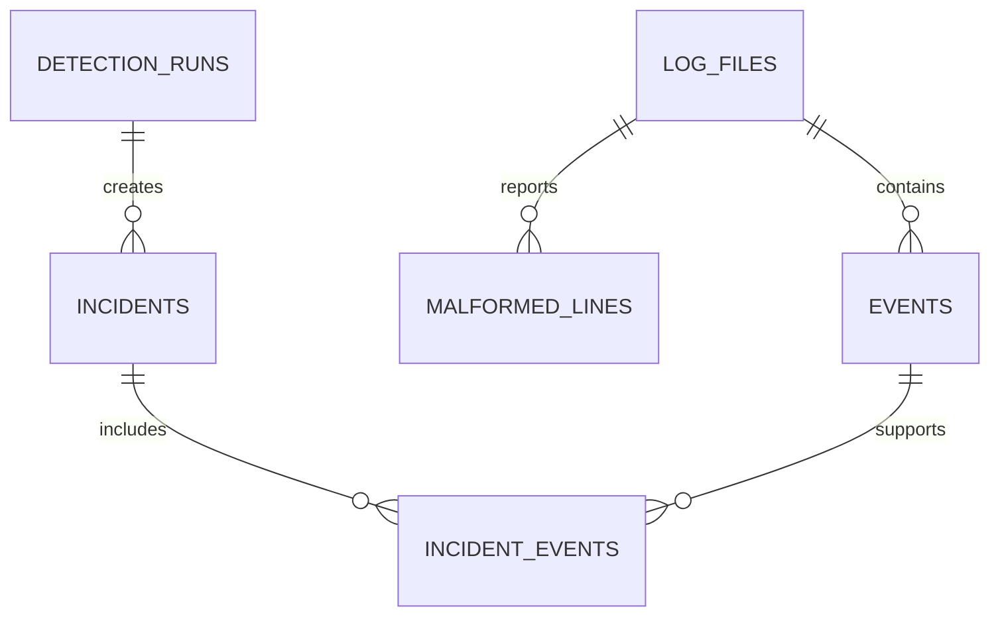

# LogShield Technical Notes

## Purpose and scope

LogShield is a single-user, offline desktop application for defensive analysis of local SSH authentication logs. It accepts one documented line format, records valid authentication events and malformed lines, detects repeated failures by source address, supports review of resulting incidents, and exports reports. Sample records are fictional and use documentation-only IP ranges. The application does not monitor a live network, call external services, or train a classifier.

## Architecture

The four screens are Security Overview, Log Import & Event Explorer, Detection Rules & Runs, and Incidents & Reports. The UI sends requests to service objects and renders plain responses. The import and detection workflows use Qt workers so parsing and analysis do not block the event loop. Services coordinate the parser, detector, and SQLite repositories. Algorithms do not import Qt and do not access the database.

SQLite connections enable foreign keys for each connection. Multi-record imports and detection runs use explicit write transactions. Repositories own SQL and use bound parameters for user-supplied values. The database is initialized from `app/database/schema.sql` at application startup.

## Data model

- `log_files` stores filename, import time, SHA-256 digest, line count, and malformed count. The digest is unique to prevent duplicate imports.
- `events` stores normalized timestamp, source IP, username, outcome, source file, and line number. `(file_id, line_no)` is unique; outcomes are constrained to `FAILED` and `SUCCESS`.
- `malformed_lines` stores the original line, its source line number, and parser reason. It cascades with its source file.
- `detection_runs` stores the selected threshold, window in seconds, and run time. Threshold and window ranges are constrained in the schema.
- `incidents` stores the run, source, start/end times, failure count, severity, review status, note, and status-change timestamp.
- `incident_events` links exact supporting event IDs to each incident.

## Parsing and detection

`LogParser` accepts the catalog's SSH password-result pattern, parses ISO-8601 timestamps, canonicalizes IPv4/IPv6 addresses, and returns malformed records with a reason instead of stopping the import. Import validates extension and the 20 MB size limit, hashes the file, parses it in a worker, and commits file metadata, valid events, and malformed lines together.

`DetectionEngine` sorts events by timestamp and line number. For each IP, a `collections.deque` retains failed events inside the configured inclusive window. When the queue reaches the threshold, it opens or extends an incident. A successful login from that IP within the window after the latest incident end raises severity to HIGH and adds the success event to the evidence links. Each event enters/leaves its IP window at most once after sorting.

### Catalog worked example

With threshold 5 and window 10 minutes, failures at 08:00:10, 08:02:30, 08:04:00, 08:07:45, and 08:09:55 produce an incident from 08:00:10 through 08:09:55 with five failures. A same-IP successful login at 08:12:00 is inside the ten-minute post-incident window, so severity becomes HIGH and the success record is linked as evidence. Four failures with no window containing five do not produce an incident.

## Search, dashboard, and reports

Event queries are paginated (maximum 200 per page). IP, username, outcome, start, and end filters combine with AND semantics. Time bounds and page arguments are validated in the service layer. Per-IP details are calculated from stored events rather than the currently visible page.

The dashboard aggregates stored event totals, failed logins per hour, the ten most failure-active IPs, and recent incidents. Dashboard incident summaries retain run and incident IDs so selecting a row opens the corresponding incident. The HIGH-only control filters the displayed results for the selected run; it does not change a run's parameters or stored incidents.

CSV and JSON reports include run parameters, incident rows, and counts. Zero-incident runs produce valid reports that state the incident count is zero. Review changes validate status and note length, are scoped to the run and incident IDs, and persist their update timestamp.

## Verification

`python -m pytest` covers parsing, malformed input, IPv4/IPv6 canonicalization, window boundaries, isolation by IP, incident merging, persistence, duplicate imports, report export, review updates, UI states, and a GUI-to-service workflow using a temporary SQLite database. The deterministic sample generator produces more than 1,000 lines over two days, three attack bursts, a near miss, malformed records, and a small duplicate-import sample.

## Known environment note

The project specification targets Python 3.11 or 3.12. The attached workstation exposed Python 3.13.12 during this implementation, so the full suite was executed with Python 3.13.12. The project source and pinned requirements continue to target Python 3.11/3.12; rerun the suite in the team's selected version before submission.
